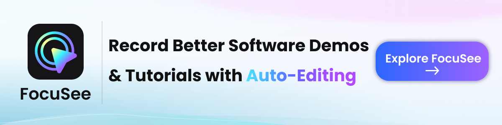

# ❤️ Sponsor PM Skills

This library is free and MIT-licensed. Sponsorship pays for the work that keeps it that way: re-testing skills against new models, building skills from community requests, and keeping the playground and docs running.

- **Companies:** the placements below put your product in front of the people who use this library. To book one, email **[mohit15856@gmail.com](mailto:mohit15856@gmail.com?subject=Sponsoring%20PM%20Skills)**.
- **Individuals:** **[become a sponsor on GitHub](https://github.com/sponsors/mohitagw15856)** or **[buy me a coffee](https://www.buymeacoffee.com/mohit15856)**.

## Current sponsor

  <a href="https://focusee.ai/?utm_source=github&utm_medium=display&utm_campaign=pm_claude_skills_2611&utm_content=sponsors_page">
    <picture>
      <source media="(prefers-color-scheme: dark)" srcset="assets/sponsors/focusee-dark.png">
      
    </picture>
  </a>

**FocuSee** holds the README banner. It went live on 25 November 2026.

## Who you reach

The audience is product managers, engineers, founders and operators who use AI assistants for professional work, plus a Chinese-speaking audience through the Chinese README and the Gitee and GitCode mirrors.

<!-- sponsor-reach:start (written by scripts/sponsor-report.mjs --update-docs) -->
Figures as of 26 November 2026:

| Measure | Figure | Source |
|---|---:|---|
| GitHub stars | 1,608 | GitHub |
| Forks | 290 | GitHub |
| Repository page views, last 14 days | 14,366 | GitHub traffic |
| Unique repository visitors, last 14 days | 6,860 | GitHub traffic |
| Views of the repository front page, where the README banner sits, last 14 days | 1,720 (1,380 unique) | GitHub traffic |
| npm downloads, last 7 days | 1,962 | npm |
| npm downloads, last 30 days | 11,086 | npm |

Top source of visitors in those 14 days: Google, 4,772 views.
<!-- sponsor-reach:end -->

Most visitors arrive from search. Stars and weekly npm downloads refresh daily in the image below. Playground visit counts are available on request.

  <picture>
    <source media="(prefers-color-scheme: dark)" srcset="https://mohitagw15856.github.io/pm-claude-skills/live/stats.svg">
    <source media="(prefers-color-scheme: light)" srcset="https://mohitagw15856.github.io/pm-claude-skills/live/stats-light.svg">
    
  </picture>

## Placements for companies

Each placement is sold by the month, to one sponsor at a time. Pricing is on request: email [mohit15856@gmail.com](mailto:mohit15856@gmail.com?subject=Sponsoring%20PM%20Skills) with the placement and the months you want.

| Placement | Where it appears | What you supply |
|---|---|---|
| **README banner** | Top of the English README, directly under the title, labelled "Sponsored by". Light and dark versions. | Two PNG banners at 1200 by 300, alt text, a link |
| **Chinese README banner** | Top of `README.zh-CN.md`. The Gitee and GitCode mirrors show the Chinese README as their front page. | The same, with Chinese alt text |
| **Playground and site** | Logo and link on the sponsor wall of the community page and in the playground footer | A logo, a link |
| **Release newsletter** | One labelled sponsor line in the newsletter sent with each release | Up to 30 words and a link |
| **Skill of the week** | "Supported by" line on the weekly featured-skill post | Up to 20 words and a link |
| **Sponsored skill or bundle** | A skill about your own product, in a bundle labelled as sponsored. See the rules below. | Product documentation and a reviewer on your side |

The same information as a printable media kit: **[sponsor page](https://mohitagw15856.github.io/pm-claude-skills/sponsor.html)**.

Placements can be combined. A natural pairing is a banner with a sponsored skill: for example a screen recording tool beside [`demo-video-kit`](skills/demo-video-kit/SKILL.md), or a design tool beside [`stitch-design-handoff`](skills/stitch-design-handoff/SKILL.md).

## Terms

- **Fixed term.** A slot runs for a term agreed up front, normally one month from the day it goes live, and carries its month in the repository history, for example "Add FocuSee sponsor banner (Nov 2026)".
- **One sponsor per slot.** No rotation inside a term and no second banner beside yours.
- **Renewal.** The current sponsor has first refusal on the next term until ten days before the current one ends. After that the slot is open to the next sponsor.
- **Changeover.** The banner goes up on the first day of the term and comes down on the last. Marks are removed promptly when a term ends.
- **Links.** UTM parameters are welcome. GitHub strips scripts and tracking pixels, so none are accepted.
- **A polite no** to crypto, gambling and anything that conflicts with the project's trust model, whatever the budget.

## What you get back each month

Within five days of the end of each term you receive a short report: repository views and unique visitors, views of the page your placement sits on, top referrers and npm downloads for the term. Clicks are counted on your side under your UTM campaign, since GitHub does not report outbound clicks. The report is produced by [`scripts/sponsor-report.mjs`](scripts/sponsor-report.mjs), so every sponsor gets the same figures from the same sources.

## Sponsored skills: the rules

A sponsor may fund a skill or a bundle about its own product. To keep the library something readers can trust:

1. **Labelled.** The skill's description and first line say it is sponsored and by whom, and it ships in a bundle marked as sponsored.
2. **Your product only.** The skill explains how to do a job with your product. It does not compare you with competitors or steer general skills towards you.
3. **Same gates.** It passes the same SkillCheck, security audit and review as any other skill, and can be declined.
4. **No bought results.** Sponsorship never buys eval scores, benchmark results, leaderboard position, or a mention inside an unsponsored skill.
5. **Removable.** When the term ends the skill either becomes a normal community listing in [`COMMUNITY-SKILLS.md`](COMMUNITY-SKILLS.md), maintained by you, or is retired.

## Tiers for individuals

Through [GitHub Sponsors](https://github.com/sponsors/mohitagw15856):

| Tier | / month | What you get |
|------|--------:|--------------|
| ☕ **Supporter** | $5 | Your name in this file · sponsor badge |
| 🚀 **Backer** | $25 | Everything above · priority on your skill requests · a vote on the roadmap |
| 🏢 **Sustaining** | $100 | Everything above · your logo and link on the site · one custom skill built for you each quarter |
| 💎 **Partner** | $500 | Everything above · a private skill pack built for your team · priority support and a quarterly review call |

The playground has its own naming tiers (a named Boardroom bench, a constellation label): see [docs/SPONSORSHIP.md](docs/SPONSORSHIP.md).

## Where the money goes

- Prizes for the monthly [Skill Cup](SKILL-CUP.md): [sponsor a Cup](docs/SPONSOR-THE-CUP.md) and the winner is paid for the best new skill
- New skills from [community requests](https://github.com/mohitagw15856/pm-claude-skills/issues/new?template=submit-skill.yml)
- Re-running the [eval benchmark](https://mohitagw15856.github.io/pm-claude-skills/benchmark.html) as models change
- Keeping the playground, Skills Hub and tools running and free

---
*Prefer a one-off? [Buy me a coffee](https://www.buymeacoffee.com/mohit15856). Want a custom skill pack for your team without a subscription? Open a [discussion](https://github.com/mohitagw15856/pm-claude-skills/discussions).*
