# Skill de Postmortem de Incidente

Este skill produce un documento completo de postmortem de incidente que sigue el formato estándar de la industria. El resultado aplica un enfoque sin culpables en todo el documento — brechas del sistema sobre fallos individuales — e impulsa hacia ítems de acción específicos y cerrables en lugar de compromisos de proceso vagos.

> **¿No es exactamente esto?** Usa `agent-incident-postmortem` cuando un agente de IA causó el incidente (uso desenfrenado de herramientas, una alucinación enviada).

## Propone Acciones

Los ítems de acción no tienen que quedarse en la página: pásalos a [`action-runner`](../action-runner/SKILL.md), que los vista previa (dry-run, valorados por riesgo), ejecuta solo lo que apruebas a través del MCP de acción conectado, y registra lo que se hizo en el brain. Típico: **crear un issue de seguimiento por ítem de acción** (🟡), asignado a su propietario con una fecha de vencimiento. Este skill propone; action-runner controla y ejecuta — nunca en silencio.

## Dónde se ubica esto — convertir un incidente en soluciones

Tercero en la columna vertebral de respuesta ante incidentes: **`/slo-error-budget` (marco) →
`/debugging-log-analyser` → `incident-postmortem` → `/oncall-runbook`**. Recibe el
**diagnóstico de causa raíz** de `/debugging-log-analyser` (léelo en lugar de
re-diagnosticar) y entrega a `/oncall-runbook` **los factores contribuyentes e ítems
de acción priorizados** — y el presupuesto de error de `/slo-error-budget` decide cuán
urgentes son esas acciones. *Sin culpables*, *causa raíz vs factores contribuyentes* e
*ítem de acción* se definen una sola vez en [`docs/craft/incident-response.md`](../../docs/craft/incident-response.md);
ser sin culpables es la regla que carga el peso.

## El bucle

Un postmortem falla en el momento en que asigna culpa — los datos honestos se secan y cada
incidente futuro es reportado insuficientemente. La Fase 1 establece ese marco; todo depende de ello.

1. **Establece el enfoque sin culpables primero.** Establece claramente que esto examina el *sistema*
   que permitió que una persona competente tome esa acción, nunca la persona. Esto no es
   educación — es la precondición para la cronología veraz que el resto del skill necesita.
   **Hecho cuando:** el enfoque es explícito y ninguna oración en el documento culpa a un
   individuo; los fallos se atribuyen a brechas del sistema.
2. **Construye la cronología a partir de evidencia.** Reconstruye inicio → detección → mitigación →
   resolución con timestamps reales (del diagnóstico y logs, no de la memoria). Detección,
   mitigación y resolución son eventos distintos — rastrea cada uno.
   **Hecho cuando:** la cronología tiene timestamps reales y separa detección/mitigación/
   resolución, y el impacto está cuantificado (usuarios, duración, alcance).
3. **Encuentra la causa raíz Y los factores contribuyentes.** La causa raíz es una sola cosa;
   los factores contribuyentes son lo que permitió que llegue a los usuarios y persista (la alerta
   perdida, el canary saltado, el runbook poco claro). Un postmortem con causa raíz y sin
   factores contribuyentes no ha buscado lo suficientemente.
   **Hecho cuando:** al menos se nombren los factores contribuyentes que cargan peso, cada uno
   apuntando a una brecha del sistema que es reparable.
4. **Impulsa hacia ítems de acción con propietario y fecha — gobernados por el presupuesto.** Convierte
   factores en ítems de acción específicos, cada uno con propietario y fecha; los ítems vagas como
   "mejorar monitoreo" se deterioran. Priorízalos contra el presupuesto de error (gastado → ahora;
   saludable → pronto).
   **Hecho cuando:** cada ítem de acción tiene propietario y fecha, y `/oncall-runbook` podría
   convertir los aprendizajes de detección/mitigación en una entrada sin re-analizar el incidente.

## Entradas Requeridas

Trabaja con lo que se da. Si alguno de estos falta, aún produce el resultado completo: rellena
cada brecha con una asunción razonable marcada *(asumido, confirmar)* y lista esas asunciones al final.
Haz una pregunta solo cuando el tema principal en sí falta (no hay nada sobre lo que escribir).
- **Título del incidente / ID**
- **Severidad** (P1 / P2 / P3 o SEV1 / SEV2 / SEV3)
- **Fecha y duración** del incidente
- **Qué pasó** (notas ásperas están bien — el skill las estructurará)
- **Servicios o sistemas afectados**
- **Impacto del cliente** (cuántos usuarios, qué se degradó)
- **Cómo se detectó**
- **Cómo se resolvió**
- **Primeros pensamientos sobre la causa raíz**
- **Ítems de acción ya identificados** (opcional)
- **Respondedores** (quién estaba on-call o respondió — nombres o roles; usado para la cronología, no para culpa)
- **Comunicaciones de cliente o externas enviadas** (opcional — cualquier actualización de página de estado, emails o mensajes de soporte con timestamps)

## Lee desde / Escribe en el Brain

Si existe un [`professional-brain`](../professional-brain/SKILL.md) (`brain/`), úsalo antes de preguntar:

- **Lee primero:** el archivo `entities/` del sistema afectado y cualquier `decisions/` relacionada o incidentes anteriores (las causas raíces recurrentes son lo más importante a resaltar).
- **Escribe después:** registra los ítems de acción y decisiones en `decisions/`, y el aprendizaje de causa raíz en `knowledge/` — etiqueta una causa medida como `[data]` y una sospechada como `[hunch]`, nunca al revés.

## Materiales Más Profundos

- **`references/root-cause-digging.md`** — cinco porqués hechos correctamente (para en una propiedad del sistema modificable, rama en cadenas de causa/detección/respuesta), una taxonomía de factores contribuyentes a barrer, y reescrituras de lenguaje culpabilizante → sistémico. Úsalo mientras escribes la sección Causa Raíz y para replantear cualquier entrada de notas culpabilizante.
- **`templates/review-meeting-agenda.md`** — una agenda de 45 minutos, centrada en documentos, para la reunión de revisión de postmortem, con reglas básicas y una puerta de control de calidad de ítems de acción. Ofrécela junto al postmortem terminado.

## Formato de Salida

---

# Postmortem de Incidente: [Título del Incidente]

**ID del Incidente:** [ID]
**Severidad:** [P1/P2/P3]
**Fecha:** [Fecha]
**Duración:** [Hora de inicio → Hora de resolución — duración total]
**Estado:** [Resuelto / Monitoreando / En Curso]
**Autor:** [Dejar en blanco para que el usuario complete]
**Última actualización:** [Fecha]

---

## Resumen Ejecutivo

[3–5 oraciones. Describe qué pasó, quién fue afectado y qué se hizo para resolverlo. Escrito para un stakeholder no técnico. Sin jerga. Sin culpa.]

---

## Impacto

| Dimensión | Detalles |
|---|---|
| **Usuarios afectados** | [Número o porcentaje] |
| **Servicios degradados** | [Lista de servicios afectados] |
| **Impacto de negocio** | [Ingresos, brecha de SLA, tickets de soporte, etc. si se conoce] |
| **Duración** | [Tiempo total desde la primera detección hasta la resolución completa] |

---

## Cronología

Lista eventos en orden cronológico. Cada entrada: `[HH:MM UTC] — [Qué pasó. Quién hizo qué. Qué cambió.]`

Reglas para entradas de cronología:
- Usa lenguaje pasivo o enfocado en el sistema — evita "X cometió un error"
- Incluye: primer síntoma, detección, escalada, hipótesis probada, fix aplicado, confirmación de resolución
- Nota el tiempo entre eventos clave (ej. "22 minutos entre detección y escalada")

**Cronología, dibujada** — también renderiza la cronología del incidente como un Gantt de Mermaid para que los huecos (ej. detección → escalada) sean visibles de un vistazo (se renderiza en vivo en el playground y se exporta como PNG). Usa las fases del incidente como barras; mantenlo sin culpables y enfocado en el sistema:

```mermaid
gantt
    title Cronología del incidente (UTC)
    dateFormat HH:mm
    axisFormat %H:%M
    section Fases
        Impacto no detectado   :22:00, 18m
        Detección           :milestone, 22:18, 0m
        Investigación       :22:18, 22m
        Mitigación          :22:40, 15m
        Resuelto            :milestone, 22:55, 0m
```

---

## Causa Raíz

**Causa raíz primaria:** [Una oración clara. Técnica pero llana. "Una misconfiguration del deployment causó..."]

**Factores contribuyentes:**
- [Factor 1 — ej. falta de deployment canary significó que el cambio golpeó el 100% del tráfico inmediatamente]
- [Factor 2 — ej. el umbral de alerta estaba establecido demasiado alto para capturar la degradación inicial]
- [Factor 3 — agrega tantos como sean relevantes]

**¿Por qué nuestras salvaguardas existentes no previnieron esto?**
[Párrafo honesto explicando por qué monitoreo, pruebas o procesos no capturaron esto antes. Aquí es donde importa el análisis sin culpables — enfócate en brechas del sistema, no en fallos individuales.]

---

## Detección

- **¿Cómo se detectó primero?** [Reporte de cliente / alerta automatizada / monitoreo interno / observación manual]
- **Tiempo desde el inicio del incidente hasta la detección:** [X minutos]
- **¿Deberíamos haber detectado esto más rápido?** [Sí / No — y por qué]

---

## Resolución

**¿Qué lo arregló?** [Descripción clara del fix real — un párrafo]
**¿Por qué funcionó esto?** [Breve explicación técnica]
**¿Hubo una mitigación temporal antes de la resolución completa?** [Sí/No — describe si sí]

---

## Ítems de Acción

| # | Acción | Propietario | Fecha de Vencimiento | Prioridad |
|---|---|---|---|---|
| 1 | [Acción específica, testeable] | [Equipo o persona] | [Fecha] | P1/P2/P3 |

Reglas para ítems de acción:
- Cada acción debe ser específica suficiente para cerrar como "hecho" o "no hecho" — sin ítems vagos como "mejorar monitoreo"
- Distingue entre: **Prevenir recurrencia** (fix la causa raíz), **Mejorar detección** (atrápalo más rápido la próxima vez), **Mejorar respuesta** (resuélvelo más rápido la próxima vez)
- Asigna un propietario real — no "equipo" o "TBD" si es evitable
- Señala acciones P1 como ítems que bloquean el incidente de ser marcado como completamente cerrado

---

## Qué Salió Bien

[3–5 observaciones honestas sobre la respuesta. Incluye: colaboración rápida, buenos runbooks usados, escalada efectiva, comunicación clara. Esta sección construye confianza en el equipo y refuerza buenos hábitos.]

---

## Lecciones Aprendidas

[3–5 insights clave de este incidente que vale la pena compartir más allá de este equipo. Escribe estos como lecciones transferibles — ej. "Nuestro runbook para failover de base de datos no consideró read-replica lag. Todos los runbooks involucrando failover de base de datos deben ser revisados."]

---

## Registro de Comunicación

[Opcional — lista comunicaciones externas enviadas: actualizaciones de página de estado, emails de cliente, respuestas de soporte. Incluye timestamps.]

---

## Rúbrica de Puntuación (0–40)

Puntúa cualquier output de este skill antes de entregarlo; 32+ es calidad para enviar.

| Dimensión | 0 | 5 | 10 |
|---|---|---|---|
| Ausencia de culpa con verdad | Nombra y avergüenza, o sanitiza tanto que la historia desaparece | Lenguaje sin culpa pero acciones individuales borrosas | Las acciones de los individuos se establecen factualmente dentro de un marco de sistemas — honesto y seguro a la vez |
| Profundidad de causa raíz | Se detiene en el síntoma o "error humano" | Nombra una brecha del sistema pero solo una profundidad "por qué" | Causa raíz más factores contribuyentes explican por qué el sistema lo permitió, no solo qué se rompió |
| Calidad forense de cronología | Escasa, desordenada o falta detección-a-resolución beats | Completa pero sin timestamps o puntos de decisión | Timestamped, incluye lag de detección, puntos de decisión y dead ends realmente explorados |
| Responsabilidad de ítems de acción | Mejoras vagas, sin propietarios | Propietarios asignados pero ítems sin ticketear o sin fecha | Cada ítem ticketeable con propietario y fecha de vencimiento, mapeado a una causa raíz o factor contribuyente |

## Controles de Calidad

- [ ] La cronología no tiene lenguaje enfocado en culpa
- [ ] La causa raíz es específica (no "error humano")
- [ ] La causa raíz responde "¿por qué pasó esto?" no solo "¿qué pasó?" — nombra una brecha de sistema o proceso, no un síntoma
- [ ] Los factores contribuyentes explican las brechas sistémicas
- [ ] Cada ítem de acción tiene propietario y fecha de vencimiento
- [ ] La sección "Qué salió bien" es genuina, no token
- [ ] Ningún ítem de acción contiene lenguaje vago como "mejorar monitoreo", "aumentar resilencia" o "mejor testing" — cada uno debe nombrar un cambio específico
- [ ] El resumen ejecutivo es legible por liderazgo no técnico

## Anti-Patrones

- [ ] No asignes culpa a individuos — los postmortems deben enfocarse en fallos de sistema y proceso
- [ ] No escribas ítems de acción con lenguaje vago como "mejorar monitoreo" — cada uno debe nombrar un cambio específico, ownable
- [ ] No omitas los factores contribuyentes — la causa raíz sola pierde los problemas sistémicos que permiten incidentes
- [ ] No omitas la cronología de detección — cuánto tiempo tardó en detectar importa tanto como cuánto tardó en resolver
- [ ] No trates el postmortem como cerrado hasta que todos los ítems de acción tengan propietarios nombrados y fechas de vencimiento

## Ejemplos de Uso
- "Escribe un postmortem para el apagón de [nombre del incidente]"
- "Ayúdame a escribir un reporte de incidente P1"
- "Genera un documento RCA para [servicio] cayendo el [fecha]"
- "Redacta un postmortem sin culpables de estas notas: [pega notas]"

## Frases de Disparo de Ejemplo

- "Escribe un postmortem."
- "Escribe el reporte de incidente."
- "Escribe la revisión P1."
- "Haz un análisis de causa raíz del apagón."
