# इंसिडेंट पोस्टमॉर्टम स्किल

यह स्किल उद्योग-मानक प्रारूप के अनुसार एक पूरा, दोष-रहित इंसिडेंट पोस्टमॉर्टम दस्तावेज़ तैयार करती है। आउटपुट पूरे में दोष-रहित ढाँचा लागू करता है — व्यक्तिगत विफलताओं के बजाय सिस्टम की कमियाँ — और अस्पष्ट प्रक्रिया वादों के बजाय विशिष्ट, बंद करने योग्य कार्रवाई आइटम की ओर ले जाता है।

> **बिल्कुल यही नहीं चाहिए?** जब किसी AI एजेंट ने घटना पैदा की हो (बेक़ाबू टूल उपयोग, शिप हुआ हैलुसिनेशन), तो `agent-incident-postmortem` का उपयोग करें।

## कार्रवाइयाँ प्रस्तावित करता है

कार्रवाई आइटम को पृष्ठ पर ही नहीं रहना है: उन्हें [`action-runner`](../action-runner/SKILL.md) को सौंपें, जो उनका पूर्वावलोकन करता है (dry-run, जोखिम-रेटेड), जुड़े action MCP के ज़रिए सिर्फ़ वही चलाता है जिसे आप मंज़ूर करें, और जो हुआ उसे brain में दर्ज करता है। सामान्य: **प्रति कार्रवाई आइटम एक फ़ॉलो-अप इश्यू दर्ज करना** (🟡), उसके स्वामी को नियत तिथि के साथ असाइन। यह स्किल प्रस्तावित करती है; action-runner गेट करता और चलाता है — कभी चुपचाप नहीं।

## यह कहाँ बैठता है — घटना को सुधारों में बदलना

इंसिडेंट-रिस्पॉन्स रीढ़ में तीसरा: **`/slo-error-budget` (ढाँचा) →
`/debugging-log-analyser` → `incident-postmortem` → `/oncall-runbook`**। यह `/debugging-log-analyser` से
**मूल-कारण निदान** प्राप्त करता है (फिर से निदान करने के बजाय उसे पढ़ें) और `/oncall-runbook` को
**योगदान कारक और प्राथमिकता-क्रम वाले कार्रवाई आइटम** सौंपता है — और `/slo-error-budget` का error budget तय करता है कि वे
कार्रवाइयाँ कितनी अत्यावश्यक हैं। *दोष-रहित*, *मूल कारण बनाम योगदान कारक*, और *कार्रवाई आइटम*
[`docs/craft/incident-response.md`](../../docs/craft/incident-response.md) में एक ही बार परिभाषित हैं;
दोष-रहित होना भार-वाहक नियम है।

## चक्र

पोस्टमॉर्टम उसी क्षण विफल हो जाता है जब वह दोष मढ़ता है — ईमानदार डेटा सूख जाता है और हर
भविष्य की घटना कम रिपोर्ट होती है। चरण 1 वह ढाँचा तय करता है; सब कुछ उसी पर निर्भर है।

1. **पहले दोष-रहित ढाँचा स्थापित करें।** शुरू में ही बताएँ कि यह उस *सिस्टम* की जाँच है
   जिसने एक सक्षम व्यक्ति को वह कदम उठाने दिया, कभी व्यक्ति की नहीं। यह शिष्टाचार नहीं है —
   यह उस सच्ची समयरेखा की पूर्वशर्त है जिसकी बाकी स्किल को ज़रूरत है।
   **पूरा तब जब:** ढाँचा स्पष्ट है और दस्तावेज़ का कोई वाक्य किसी व्यक्ति को दोष नहीं देता;
   विफलताएँ सिस्टम की कमियों को आरोपित हैं।
2. **साक्ष्य से समयरेखा बनाएँ।** शुरुआत → पहचान → शमन → समाधान को वास्तविक टाइमस्टैम्प
   (निदान और लॉग से, स्मृति से नहीं) के साथ पुनर्निर्मित करें। पहचान,
   शमन और समाधान अलग-अलग घटनाएँ हैं — हर एक को ट्रैक करें।
   **पूरा तब जब:** समयरेखा में वास्तविक टाइमस्टैम्प हैं और पहचान/शमन/समाधान अलग हैं,
   और प्रभाव परिमाणित है (उपयोगकर्ता, अवधि, दायरा)।
3. **मूल कारण और योगदान कारक दोनों खोजें।** मूल कारण एक चीज़ है;
   योगदान कारक वे हैं जिन्होंने उसे उपयोगकर्ताओं तक पहुँचने और बने रहने दिया (गायब अलर्ट,
   छोड़ा गया कैनरी, अस्पष्ट runbook)। जिस पोस्टमॉर्टम में मूल कारण है पर कोई
   योगदान कारक नहीं, उसने पर्याप्त गहराई से नहीं देखा।
   **पूरा तब जब:** कम से कम भार-वाहक योगदान कारक नामित हैं, हर एक किसी ठीक करने योग्य
   सिस्टम कमी की ओर इशारा करता है।
4. **स्वामी और तारीख़ वाले कार्रवाई आइटम तक ले जाएँ — बजट द्वारा शासित।** कारकों को
   विशिष्ट कार्रवाई आइटम में बदलें, हर एक स्वामी और तारीख़ के साथ; अस्पष्ट "मॉनिटरिंग सुधारें"
   आइटम सड़ जाते हैं। उन्हें error budget के सापेक्ष प्राथमिकता दें (ख़र्च हुआ → अभी; स्वस्थ → जल्द)।
   **पूरा तब जब:** हर कार्रवाई आइटम का स्वामी और तारीख़ है, और `/oncall-runbook` घटना का
   फिर से विश्लेषण किए बिना पहचान/शमन की सीख को एक प्रविष्टि में बदल सके।

## आवश्यक इनपुट

जो दिया गया है उसी से काम करें। इनमें से कुछ न हो तो भी पूरा आउटपुट बनाएँ: हर खाली जगह को *(माना गया, पुष्टि करें)* चिह्नित एक उचित धारणा से भरें और अंत में उन धारणाओं की सूची दें। सवाल पहले सिर्फ़ तब पूछें जब मुख्य विषय ही न हो (लिखने के लिए कुछ हो ही नहीं)।
- **घटना का शीर्षक / ID**
- **गंभीरता** (P1 / P2 / P3 या SEV1 / SEV2 / SEV3)
- घटना की **तारीख़ और अवधि**
- **क्या हुआ** (कच्चे नोट चलेंगे — स्किल उन्हें संरचित करेगी)
- **प्रभावित सेवाएँ या सिस्टम**
- **ग्राहक प्रभाव** (कितने उपयोगकर्ता, क्या बाधित हुआ)
- **इसका पता कैसे चला**
- **इसे कैसे हल किया गया**
- **मूल कारण पर शुरुआती विचार**
- **पहले से पहचाने गए कार्रवाई आइटम** (वैकल्पिक)
- **प्रतिक्रियाकर्ता** (कौन ऑन-कॉल था या किसने प्रतिक्रिया दी — नाम या भूमिकाएँ; समयरेखा के लिए, दोष के लिए नहीं)
- **भेजे गए ग्राहक या बाहरी संचार** (वैकल्पिक — टाइमस्टैम्प सहित कोई स्टेटस पेज अपडेट, ईमेल या सपोर्ट संदेश)

## Brain से पढ़ता है / Brain में लिखता है

अगर कोई [`professional-brain`](../professional-brain/SKILL.md) (`brain/`) मौजूद है, तो पूछने से पहले उसका उपयोग करें:

- **पहले पढ़ें:** प्रभावित सिस्टम की `entities/` फ़ाइल और कोई संबंधित पिछले `decisions/` या पिछली घटनाएँ (आवर्ती मूल कारण सामने लाने लायक सबसे महत्वपूर्ण चीज़ हैं)।
- **बाद में लिखें:** कार्रवाई आइटम और निर्णय `decisions/` में, और मूल-कारण की सीख `knowledge/` में दर्ज करें — मापे गए कारण को `[data]` और संदिग्ध को `[hunch]` टैग करें, कभी उलटा नहीं।

## गहरी सामग्री

- **`references/root-cause-digging.md`** — पाँच-क्यों सही ढंग से (बदलने योग्य सिस्टम गुण पर रुकें, कारण/पहचान/प्रतिक्रिया श्रृंखलाओं में शाखाएँ बनाएँ), खंगालने के लिए योगदान-कारक वर्गीकरण, और दोष-जैसी → प्रणालीगत भाषा के पुनर्लेखन। मूल कारण खंड लिखते समय और किसी भी दोषपूर्ण इनपुट नोट को फिर से ढालने के लिए इसका उपयोग करें।
- **`templates/review-meeting-agenda.md`** — पोस्टमॉर्टम समीक्षा बैठक के लिए 45-मिनट का, दस्तावेज़-प्रथम एजेंडा, ज़मीनी नियमों और कार्रवाई-आइटम गुणवत्ता गेट के साथ। तैयार पोस्टमॉर्टम के साथ इसे पेश करें।

## आउटपुट फ़ॉर्मैट

---

# इंसिडेंट पोस्टमॉर्टम: [घटना का शीर्षक]

**घटना ID:** [ID]
**गंभीरता:** [P1/P2/P3]
**तारीख़:** [तारीख़]
**अवधि:** [शुरुआत समय → समाधान समय — कुल अवधि]
**स्थिति:** [हल / निगरानी में / जारी]
**लेखक:** [उपयोगकर्ता के भरने के लिए ख़ाली छोड़ें]
**अंतिम अपडेट:** [तारीख़]

---

## कार्यकारी सारांश

[3–5 वाक्य। क्या हुआ, कौन प्रभावित हुआ और हल करने के लिए क्या किया गया, बताएँ। गैर-तकनीकी हितधारक के लिए लिखा गया। कोई जार्गन नहीं। कोई दोष नहीं।]

---

## प्रभाव

| आयाम | विवरण |
|---|---|
| **प्रभावित उपयोगकर्ता** | [संख्या या प्रतिशत] |
| **बाधित सेवाएँ** | [प्रभावित सेवाएँ सूचीबद्ध करें] |
| **व्यावसायिक प्रभाव** | [राजस्व, SLA उल्लंघन, सपोर्ट टिकट आदि, ज्ञात हो तो] |
| **अवधि** | [पहली पहचान से पूर्ण समाधान तक कुल समय] |

---

## समयरेखा

घटनाओं को कालानुक्रमिक क्रम में सूचीबद्ध करें। हर प्रविष्टि: `[HH:MM UTC] — [क्या हुआ। किसने क्या किया। क्या बदला।]`

समयरेखा प्रविष्टियों के नियम:
- निष्क्रिय या सिस्टम-केंद्रित भाषा उपयोग करें — "X ने ग़लती की" से बचें
- शामिल करें: पहला लक्षण, पहचान, एस्केलेशन, परखी गई परिकल्पना, लागू फ़िक्स, समाधान की पुष्टि
- मुख्य घटनाओं के बीच का समय नोट करें (जैसे "पहचान और एस्केलेशन के बीच 22 मिनट")

**समयरेखा, चित्रित** — घटना की समयरेखा को Mermaid Gantt के रूप में भी बनाएँ ताकि अंतराल (जैसे पहचान → एस्केलेशन) एक नज़र में दिखें (यह playground में लाइव रेंडर होता है और PNG में एक्सपोर्ट होता है)। घटना के चरणों को बार के रूप में उपयोग करें; दोष-रहित और सिस्टम-केंद्रित रखें:

```mermaid
gantt
    title Incident timeline (UTC)
    dateFormat HH:mm
    axisFormat %H:%M
    section Phases
        Undetected impact   :22:00, 18m
        Detection           :milestone, 22:18, 0m
        Investigation       :22:18, 22m
        Mitigation          :22:40, 15m
        Resolved            :milestone, 22:55, 0m
```

---

## मूल कारण

**प्राथमिक मूल कारण:** [एक स्पष्ट वाक्य। तकनीकी पर सादा। "एक ग़लत कॉन्फ़िगर किए गए डिप्लॉयमेंट कॉन्फ़िग के कारण..."]

**योगदान कारक:**
- [कारक 1 — जैसे कैनरी डिप्लॉयमेंट की कमी से बदलाव तुरंत 100% ट्रैफ़िक पर पहुँचा]
- [कारक 2 — जैसे अलर्ट सीमा इतनी ऊँची थी कि शुरुआती गिरावट पकड़ी नहीं गई]
- [कारक 3 — जितने प्रासंगिक हों उतने जोड़ें]

**हमारे मौजूदा सुरक्षा उपायों ने इसे क्यों नहीं रोका?**
[ईमानदार अनुच्छेद जो समझाए कि मॉनिटरिंग, टेस्ट या प्रक्रियाओं ने इसे पहले क्यों नहीं पकड़ा। यहीं दोष-रहित विश्लेषण सबसे ज़्यादा मायने रखता है — व्यक्तिगत विफलताओं पर नहीं, सिस्टम की कमियों पर ध्यान दें।]

---

## पहचान

- **इसका पहली बार पता कैसे चला?** [ग्राहक रिपोर्ट / स्वचालित अलर्ट / आंतरिक मॉनिटरिंग / मैनुअल अवलोकन]
- **घटना की शुरुआत से पहचान तक का समय:** [X मिनट]
- **क्या हमें इसे तेज़ी से पकड़ना चाहिए था?** [हाँ / नहीं — और क्यों]

---

## समाधान

**इसे किसने ठीक किया?** [वास्तविक फ़िक्स का स्पष्ट विवरण — एक अनुच्छेद]
**यह क्यों काम किया?** [संक्षिप्त तकनीकी व्याख्या]
**क्या पूर्ण समाधान से पहले कोई अस्थायी शमन था?** [हाँ/नहीं — हाँ हो तो बताएँ]

---

## कार्रवाई आइटम

| # | कार्रवाई | स्वामी | नियत तिथि | प्राथमिकता |
|---|---|---|---|---|
| 1 | [विशिष्ट, परखने योग्य कार्रवाई] | [टीम या व्यक्ति] | [तारीख़] | P1/P2/P3 |

कार्रवाई आइटम के नियम:
- हर कार्रवाई इतनी विशिष्ट हो कि "हो गया" या "नहीं हुआ" के रूप में बंद की जा सके — "मॉनिटरिंग सुधारें" जैसे अस्पष्ट आइटम नहीं
- भेद करें: **पुनरावृत्ति रोकें** (मूल कारण ठीक करें), **पहचान सुधारें** (अगली बार तेज़ी से पकड़ें), **प्रतिक्रिया सुधारें** (अगली बार तेज़ी से हल करें)
- वास्तविक स्वामी असाइन करें — बचा जा सके तो "टीम" या "TBD" नहीं
- P1 कार्रवाइयों को ऐसे आइटम के रूप में चिह्नित करें जो घटना को पूरी तरह बंद चिह्नित करने से रोकते हैं

---

## क्या अच्छा रहा

[प्रतिक्रिया के बारे में 3–5 ईमानदार अवलोकन। शामिल करें: तेज़ सहयोग, अच्छे runbook का उपयोग, प्रभावी एस्केलेशन, स्पष्ट संचार। यह खंड टीम का आत्मविश्वास बनाता है और अच्छी आदतों को पुष्ट करता है।]

---

## सीखे गए सबक

[इस घटना से 3–5 मुख्य अंतर्दृष्टियाँ जो इस टीम से परे साझा करने लायक हैं। इन्हें हस्तांतरणीय सबक के रूप में लिखें — जैसे "डेटाबेस फ़ेलओवर के हमारे runbook में read-replica lag का ध्यान नहीं था। डेटाबेस फ़ेलओवर वाले सभी runbook की समीक्षा होनी चाहिए।"]

---

## संचार लॉग

[वैकल्पिक — भेजे गए बाहरी संचार सूचीबद्ध करें: स्टेटस पेज अपडेट, ग्राहक ईमेल, सपोर्ट उत्तर। टाइमस्टैम्प शामिल करें।]

---

## स्कोरिंग रूब्रिक (0–40)

इस स्किल का कोई भी आउटपुट सौंपने से पहले स्कोर करें; 32+ शिप-गुणवत्ता है।

| आयाम | 0 | 5 | 10 |
|---|---|---|---|
| सच्चाई के साथ दोष-रहितता | नाम लेकर शर्मिंदा करता है, या इतना साफ़ करता है कि कहानी ग़ायब हो जाती है | दोष-रहित शब्द पर व्यक्तिगत क्रियाएँ धुँधली | व्यक्तियों की क्रियाएँ सिस्टम ढाँचे के भीतर तथ्यात्मक रूप से बताई गईं — ईमानदार और सुरक्षित एक साथ |
| मूल-कारण की गहराई | लक्षण या "मानवीय त्रुटि" पर रुक जाता है | सिस्टम कमी नामित पर सिर्फ़ एक "क्यों" गहरा | मूल कारण और योगदान कारक समझाते हैं कि सिस्टम ने इसे क्यों होने दिया, सिर्फ़ क्या टूटा नहीं |
| समयरेखा की फ़ोरेंसिक गुणवत्ता | विरल, अव्यवस्थित, या पहचान-से-समाधान के बीट गायब | पूरी पर बिना टाइमस्टैम्प या निर्णय बिंदुओं के | टाइमस्टैम्प सहित, पहचान में देरी, निर्णय बिंदु और वास्तव में खोजे गए बंद रास्ते शामिल |
| कार्रवाई-आइटम की जवाबदेही | अस्पष्ट सुधार, कोई स्वामी नहीं | स्वामी असाइन पर आइटम टिकट-योग्य नहीं या बिना तारीख़ | हर आइटम स्वामी और नियत तिथि के साथ टिकट-योग्य, मूल कारण या योगदान कारक से जुड़ा |

## गुणवत्ता जाँच

- [ ] समयरेखा में कोई दोष-केंद्रित भाषा नहीं
- [ ] मूल कारण विशिष्ट है ("मानवीय त्रुटि" नहीं)
- [ ] मूल कारण "यह क्यों हुआ?" का उत्तर देता है, सिर्फ़ "क्या हुआ?" का नहीं — यह किसी सिस्टम या प्रक्रिया की कमी का नाम लेता है, लक्षण का नहीं
- [ ] योगदान कारक प्रणालीगत कमियाँ समझाते हैं
- [ ] हर कार्रवाई आइटम का स्वामी और नियत तिथि है
- [ ] "क्या अच्छा रहा" खंड वास्तविक है, नाममात्र नहीं
- [ ] किसी कार्रवाई आइटम में "मॉनिटरिंग सुधारें", "लचीलापन बढ़ाएँ" या "बेहतर टेस्टिंग" जैसी अस्पष्ट भाषा नहीं — हर एक को विशिष्ट बदलाव का नाम लेना चाहिए
- [ ] कार्यकारी सारांश गैर-तकनीकी नेतृत्व द्वारा पढ़ने योग्य है

## एंटी-पैटर्न

- [ ] व्यक्तियों पर दोष न मढ़ें — पोस्टमॉर्टम को सिस्टम और प्रक्रिया की विफलताओं पर ध्यान देना चाहिए
- [ ] "मॉनिटरिंग सुधारें" जैसी अस्पष्ट भाषा में कार्रवाई आइटम न लिखें — हर एक को एक विशिष्ट, स्वामित्व योग्य बदलाव का नाम लेना चाहिए
- [ ] योगदान कारक न छोड़ें — अकेला मूल कारण उन प्रणालीगत मुद्दों को चूक जाता है जो घटनाओं को सक्षम करते हैं
- [ ] पहचान की समयरेखा न छोड़ें — पता चलने में कितना समय लगा, यह उतना ही मायने रखता है जितना हल होने में लगा समय
- [ ] जब तक सभी कार्रवाई आइटम के नामित स्वामी और नियत तिथियाँ न हों, पोस्टमॉर्टम को बंद न मानें

## उपयोग के उदाहरण
- "[घटना का नाम] आउटेज के लिए पोस्टमॉर्टम लिखो"
- "P1 इंसिडेंट रिपोर्ट लिखने में मदद करो"
- "[तारीख़] को [सेवा] के डाउन होने का RCA दस्तावेज़ बनाओ"
- "इन नोट्स से दोष-रहित पोस्टमॉर्टम का मसौदा बनाओ: [नोट्स पेस्ट करें]"

## उदाहरण ट्रिगर वाक्य

- "एक पोस्टमॉर्टम लिखो।"
- "इंसिडेंट रिपोर्ट लिखो।"
- "P1 समीक्षा लिखो।"
- "आउटेज का मूल कारण विश्लेषण करो।"

इस स्किल को अपने ब्राउज़र में चलाएँ: https://mohitagw15856.github.io/pm-claude-skills/skill/incident-postmortem.html
