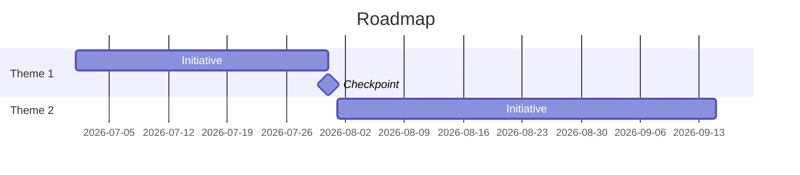

# रोडमैप कथा स्किल

प्रोडक्ट पहलों की रैंक की गई सूची को एक स्पष्ट, रणनीतिक कथा में बदलें जो अलग-अलग आइटम को कंपनी लक्ष्यों से जोड़े और एक सुसंगत प्रोडक्ट दिशा संप्रेषित करे।

## Brain से पढ़ता है / Brain में लिखता है

अगर कोई [`professional-brain`](../professional-brain/SKILL.md) (`brain/`) मौजूद है, तो जो आप पहले से जानते हैं उसे दोबारा पूछने के बजाय उसी में आधार रखें:

- **पहले पढ़ें:** `knowledge/strategy.md` (वह दिशा जिससे कथा को जुड़ना है), प्राथमिकता `decisions/`, और फ़ीचर `entities/`। `python3 ../professional-brain/scripts/brain_query.py ./brain "<roadmap theme>"` चलाएँ और हर तथ्य का स्रोत टैग साथ रखें।
- **📥 Brain को प्रस्ताव दें:** तैयार करने के बाद, अनुक्रम/प्राथमिकता निर्णयों को `decisions/` में दर्ज करने और प्रासंगिक फ़ीचर `entities/` अपडेट करने का प्रस्ताव दें, हर एक स्रोत-टैग सहित। उन्हें दिखाएँ, हाँ लें, फिर `../professional-brain/scripts/brain_write.py … --commit` से लिखें (सिर्फ़-जोड़ने वाला, डिफ़ॉल्ट रूप से dry-run)।

## ब्रीफ़ से काम करना

आपको अक्सर पूरी पहल सूची या OKR के बिना एक छोटा ब्रीफ़ (कुछ थीम, एक श्रोता) मिलेगा। **हमेशा पूरी कथा फिर भी दें** — सवाल पूछने के लिए न रुकें और `[Theme Name]` जैसे कोष्ठक वाले प्लेसहोल्डर न छोड़ें। जहाँ विवरण गायब हो, ब्रीफ़ और डोमेन से विशिष्ट, यथार्थवादी थीम, पहलें और मेट्रिक का अनुमान लगाएँ, और किसी भी अनुमानित तथ्य या संख्या को *(माना गया — पुष्टि करें)* चिह्नित करें। हर खंड ठोस सामग्री से भरें, टेम्पलेट कोष्ठकों से नहीं।

## इनपुट (जो न दिए गए हों उनका अनुमान लगाएँ — धारणाएँ लेबल करें)

- **प्राथमिकता-क्रम वाली पहल सूची** (मोटी समयरेखाओं या तिमाहियों के साथ)
- **कंपनी OKR या रणनीतिक प्राथमिकताएँ** (रोडमैप को कंपनी लक्ष्यों से जोड़ने के लिए)
- **श्रोता** (ऑल-हैंड्स, बोर्ड, निवेशक, सेल्स टीम — लहजा और गहराई बदलता है)
- **स्पष्ट रूप से रोडमैप पर न होने वाले आइटम** (वैकल्पिक पर विश्वसनीयता बढ़ाता है)

## यह कहाँ बैठता है — रीढ़ का अंतिम छोर

प्रोडक्ट-निर्णय रीढ़ में अंतिम: **`/assumption-mapper` → `/prd-template` →
`/rice-prioritisation` → `roadmap-narrative`**। यह **RICE स्कोर सहित रैंक की गई पहलें**
प्राप्त करता है और उन्हें *थीम*-स्तर की कहानी में बदलता है जिसे नेतृत्व दोहरा सके। यह
कोई नई प्राथमिकता नहीं जोड़ता — रैंकिंग ऊपर का काम है; यह स्किल उसे सुनाती है। *थीम*
और *स्रोत* एक ही बार
[`docs/craft/product-decisions.md`](../../docs/craft/product-decisions.md) में परिभाषित हैं: रोडमैप
थीम में बोलता है, और वह ऊपर के किसी [hunch] को आत्मविश्वासी वादे में नहीं बदल सकता।

## चक्र

विफलता का तरीका ऐसी कथा है जो निश्चितता बढ़ा-चढ़ाकर बताए या किसी पहल को अनाथ छोड़ दे।
चरण 1 ईमानदारी की छत तय करता है; हर बाद का दावा उसे विरासत में पाता है।

1. **प्राथमिकताएँ और स्रोत विरासत में लें — फिर से रैंक न करें।** RICE आउटपुट और
   OKR पढ़ें। हर पहल का confidence साथ लाएँ: कम-confidence दाँव को दाँव की तरह
   ("हम मानते हैं") सुनाया जाता है, प्रतिबद्धता ("हम करेंगे") की तरह नहीं।
   **पूरा तब जब:** हर दावे की निश्चितता उसके ऊपरी स्रोत टैग से मेल खाती है, और कोई
   [hunch] वादे में नहीं बदला गया।
2. **रणनीति से जुड़ती 2–3 थीम में समूहित करें।** थीम कहानी की इकाई हैं;
   RICE पंक्तियाँ उनका साक्ष्य। हर थीम के लिए वह समस्या बताएँ जिसे वह संबोधित करती है, वह
   ग्राहक जिसकी वह सेवा करती है, और वह मेट्रिक जिसे वह हिलाती है (PRD की सफलता मेट्रिक)।
   **पूरा तब जब:** हर रैंक की गई पहल ठीक एक थीम से जुड़ती है — कोई अनाथ नहीं;
   अनाथ या तो गायब थीम है या चिह्नित कथा-अंतराल, कभी अनदेखा नहीं।
3. **प्रगति खींचें।** तिमाही/अर्ध का चाप लिखें जो दिखाए कि पहले का काम बाद के काम
   को कैसे तैयार करता है — *यह* क्रम क्यों, सिर्फ़ *यह* सूची नहीं। फिर कार्यकारी सारांश:
   3–4 वाक्य जो गैर-तकनीकी हितधारक शब्दशः दोहरा सके।
   **पूरा तब जब:** अनुक्रम का RICE क्रम से परे घोषित कारण है, और सारांश
   किसी ऐसे व्यक्ति द्वारा दोहराए जाने पर टिकता है जो कमरे में नहीं था।
4. **बताएँ कि रोडमैप पर क्या *नहीं* है।** सोचे-समझे ना रणनीति का आधा हिस्सा हैं;
   उन्हें बताएँ, ताकि कथा किए गए विकल्पों की तरह पढ़ी जाए, हर कोशिश की तरह नहीं।
   **पूरा तब जब:** "अभी नहीं" खंड मौजूद है और हर प्रविष्टि का एक पंक्ति का क्यों है।

## आउटपुट संरचना

### प्रोडक्ट रोडमैप: [तिमाही/अर्ध/वर्ष]
**रणनीतिक संदर्भ:** [1 अनुच्छेद: बाज़ार का क्षण, मुख्य चुनौती, हमारी प्रतिक्रिया]

#### थीम 1: [थीम का नाम]
- रणनीतिक तर्क
- शामिल पहलें
- प्रभावित प्राथमिक मेट्रिक
- निर्भरताएँ

[हर थीम के लिए दोहराएँ]

**रोडमैप पर क्या नहीं है (और क्यों):**
[तर्क सहित 2-3 आइटम — रणनीतिक अनुशासन दिखाता है, सिर्फ़ प्राथमिकता नहीं]

**कार्यकारी सारांश (साझा करने योग्य):**
[3-4 वाक्य जो ऑल-हैंड्स या बोर्ड अपडेट में साझा किए जा सकें]

## लहजे के दिशानिर्देश
- इंजीनियर के लिए नहीं, CFO के लिए लिखें
- फ़ीचर नहीं, ग्राहक परिणामों से शुरू करें
- रोडमैप पर क्या नहीं है और क्यों, इस पर ईमानदार रहें

## समयरेखा, चित्रित
जब थीम का अनुक्रम या तारीख़ें हों, तो रोडमैप को Mermaid Gantt चार्ट के रूप में भी बनाएँ ताकि योजना का आकार दिखे (यह playground में लाइव रेंडर होता है; वास्तविक ISO तारीख़ों के साथ यह कैलेंडर .ics में भी एक्सपोर्ट होता है)। प्रति थीम/तिमाही `section` उपयोग करें और मुख्य चेकपॉइंट को माइलस्टोन चिह्नित करें।

## गहरी सामग्री

यह स्किल सहायक फ़ाइलों के साथ आती है — उपलब्ध हों तो उनका उपयोग करें:

- **`references/now-next-later.md`** — Now/Next/Later सही ढंग से: प्रतिबद्धता के क्रम, तारीख़ों का छलावरण नहीं। आउटपुट बनाते समय इसे लागू करें; इसमें वह कैलिब्रेशन और निर्णय-विवेक है जिसे ऊपर का संक्षिप्त तरीका संकुचित कर देता है।
- **`templates/roadmap-onepager.md`** — डिलिवरेबल का भरने योग्य संस्करण, गुणवत्ता-जाँच इनलाइन सहित। जब उपयोगकर्ता दस्तावेज़ खुद बनाना चाहे, उसे जनरेट करवाने के बजाय, तब यह पेश करें।

## स्कोरिंग रूब्रिक (0–40)

इस स्किल का कोई भी आउटपुट सौंपने से पहले स्कोर करें; 32+ शिप-गुणवत्ता है।

| आयाम | 0 | 5 | 10 |
|---|---|---|---|
| थीम की सुसंगति | तारीख़ों वाली फ़ीचर सूची को "कथा" का नाम दिया; कोई थीम नहीं | थीम हैं पर एक या अधिक पहलें बिना चिह्नित हुए अनाथ | हर पहल किसी थीम से जुड़ती है; जो फ़िट नहीं बैठता वह स्पष्ट रूप से कथा-अंतराल चिह्नित, चुपके से नहीं घुसाया गया |
| कारणात्मक प्रगति | तिमाहियाँ बिना आपसी जुड़ाव की कालानुक्रमिक सूची | अनुक्रम बताया गया पर "Q1 Q2 को सक्षम करता है क्योंकि…" तर्क गायब या बिना साक्ष्य दावा | हर अवधि स्पष्ट रूप से अगली को सक्षम करती है, कारणात्मक निर्भरता गद्य में तर्कित और समयरेखा में प्रतिबिंबित |
| रणनीतिक स्पष्टवादिता | कोई "रोडमैप पर क्या नहीं है" खंड नहीं | एक बहिष्करण कमज़ोर तर्क के साथ ("अभी प्राथमिकता नहीं") | रक्षा योग्य रणनीतिक तर्क के साथ ≥2 नामित बहिष्करण — कम से कम एक ऐसा विचार सहित जिसे कोई वास्तव में चाहता है |
| कार्यकारी दोहराव-योग्यता | जार्गन से भरा; कोई स्वतंत्र सारांश नहीं; CFO इसका कुछ भी दोहरा न सके | सारांश है पर बहुत लंबा, बहुत तकनीकी, या कहानी के बजाय संपीड़न जैसा | 3–4 वाक्य का सारांश जो गैर-तकनीकी हितधारक एक बार पढ़कर सही दोहरा सके, शून्य इंजीनियरिंग जार्गन |

## गुणवत्ता जाँच

- [ ] इनपुट की हर पहल किसी रणनीतिक थीम से जुड़ती है
- [ ] कार्यकारी सारांश अकेला खड़ा हो सकता है और एक बार पढ़कर सही दोहराया जा सकता है
- [ ] प्रगति कथा तिमाहियों के बीच कारणात्मक जुड़ाव दिखाती है (सिर्फ़ कालानुक्रमिक सूची नहीं)
- [ ] "रोडमैप पर क्या नहीं है" खंड में स्पष्ट तर्क के साथ कम से कम 2 आइटम हैं
- [ ] पूरी भाषा इंजीनियरिंग जार्गन से मुक्त है — परीक्षा: "क्या CFO इसे दोहरा सकता है?"

## एंटी-पैटर्न

- [ ] तारीख़ों वाली फ़ीचर सूची बनाकर उसे कथा न कहें — हर पहल किसी रणनीतिक थीम से जुड़नी चाहिए
- [ ] "रोडमैप पर क्या नहीं है" खंड न छोड़ें — इसके बिना कथा में रणनीतिक अनुशासन नहीं
- [ ] प्रगति को कालानुक्रमिक सूची की तरह न लिखें — तिमाहियों के बीच कारणात्मक जुड़ाव दिखाएँ (Q1 Q2 को सक्षम करता है क्योंकि…)
- [ ] कार्यकारी सारांश को अंत में लिखकर सारांश न मानें — इसे उस संस्करण की तरह लिखें जिसे हितधारक दोहराएँगे
- [ ] अनाथ पहलों को बिना थीम के न दिखने दें — या तो थीम बनाएँ या अंतराल को स्पष्ट रूप से चिह्नित करें

## उदाहरण ट्रिगर वाक्य

- "एक रोडमैप कथा लिखो।"
- "गैर-तकनीकी हितधारकों को प्रोडक्ट रोडमैप समझाओ।"
- "एग्ज़िक्यूटिव के साथ साझा करने योग्य रोडमैप कहानी बनाओ।"

इस स्किल को अपने ब्राउज़र में चलाएँ: https://mohitagw15856.github.io/pm-claude-skills/skill/roadmap-narrative.html
